# UI

Design screens for the staff console and the customer portal, with sample data for a software dev studio (Lumen Studio). They show the intended look. The app ships the shared parts (theme, side menu, portal tabs and components); some page layouts shown here are still to come.

- Accent: green `#0B7A62` with flat fills. The side menu is dark ink in both themes. Text is Inter.
- Staff console: one side menu grouped into Workspace, Money, Grow and Settings, with a slim top bar (Ask JoyBot, theme, team).
- Customer portal: a top bar with the business name and underlined tabs.

Images live in [docs/screens](docs/screens), rendered at 1440 px wide.

## Staff console

### Dashboard
Key numbers, today's appointments by status, to-dos, quick actions, Ask JoyBot and website visits.

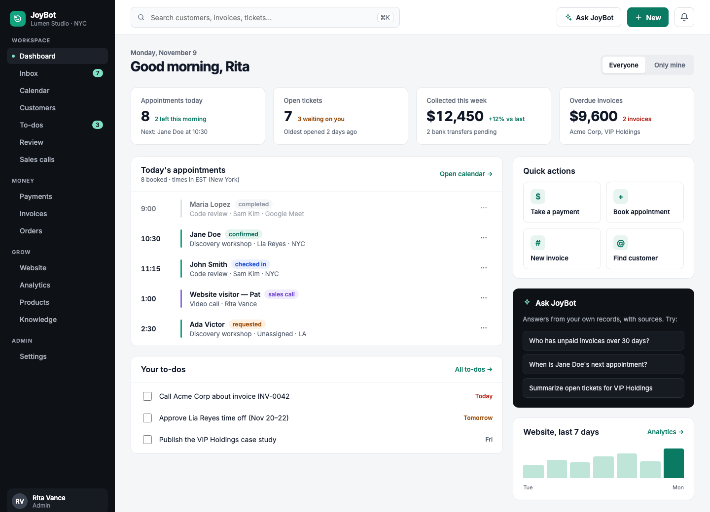

### Customer profile
One activity timeline (appointments, payments, tickets, chats), contact details with masked contacts, internal notes, and who can access the customer.

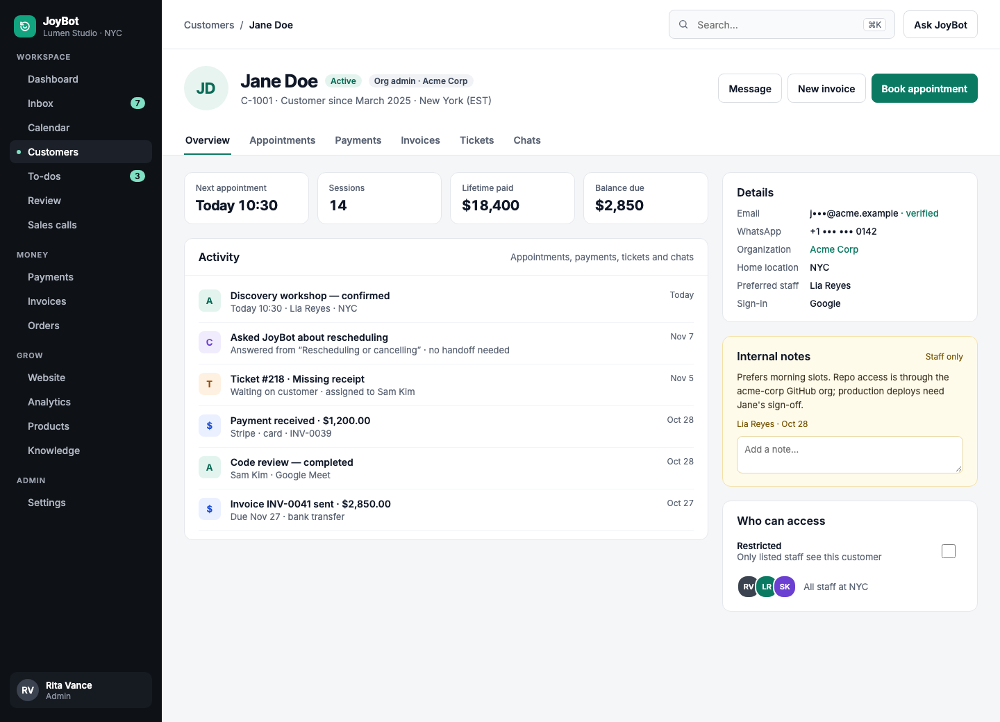

### Tickets inbox
Ticket list, conversation with the JoyBot handoff and a suggested reply that names its sources, and the customer's details alongside.

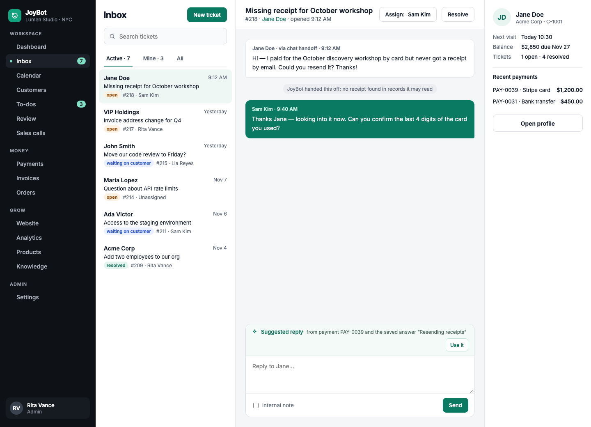

### Calendar
Day view with a column per staff member, working hours, the current time, and requests that still need staff.

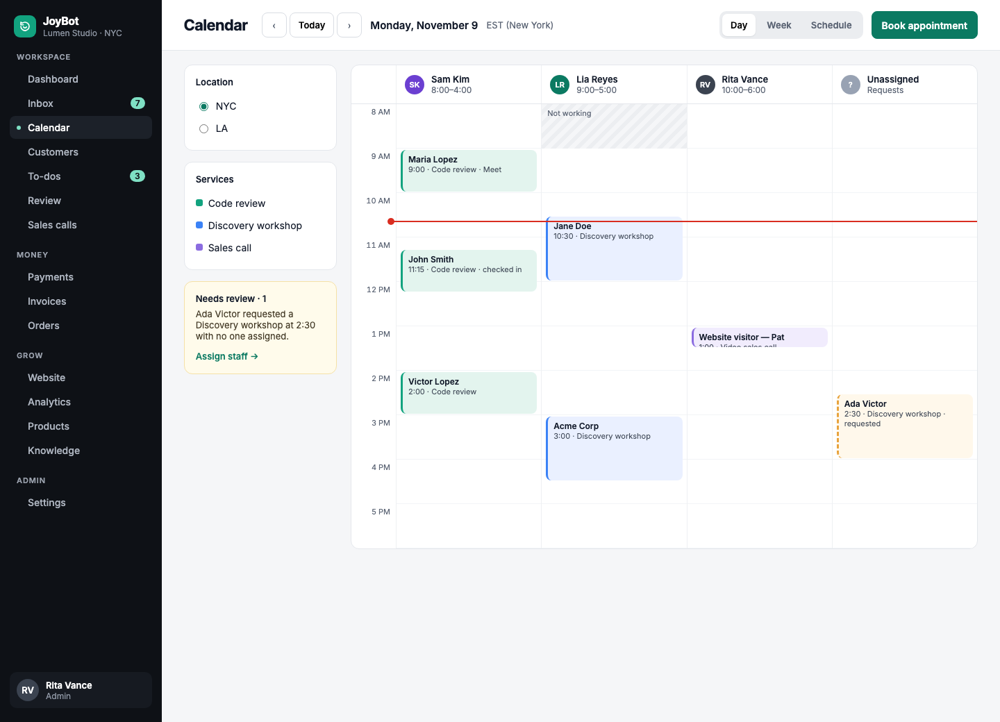

### Invoices
Totals by status, bank transfers waiting to be matched, and the invoice list with status tabs.

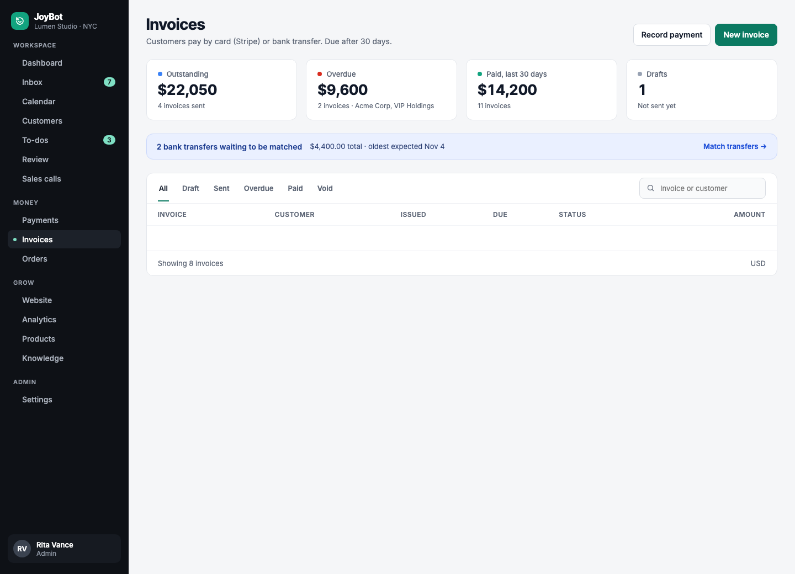

### Payments
Take a payment (card on the POS terminal, bank transfer or cash) and apply it to an invoice, match pending bank transfers, and see recent payments.

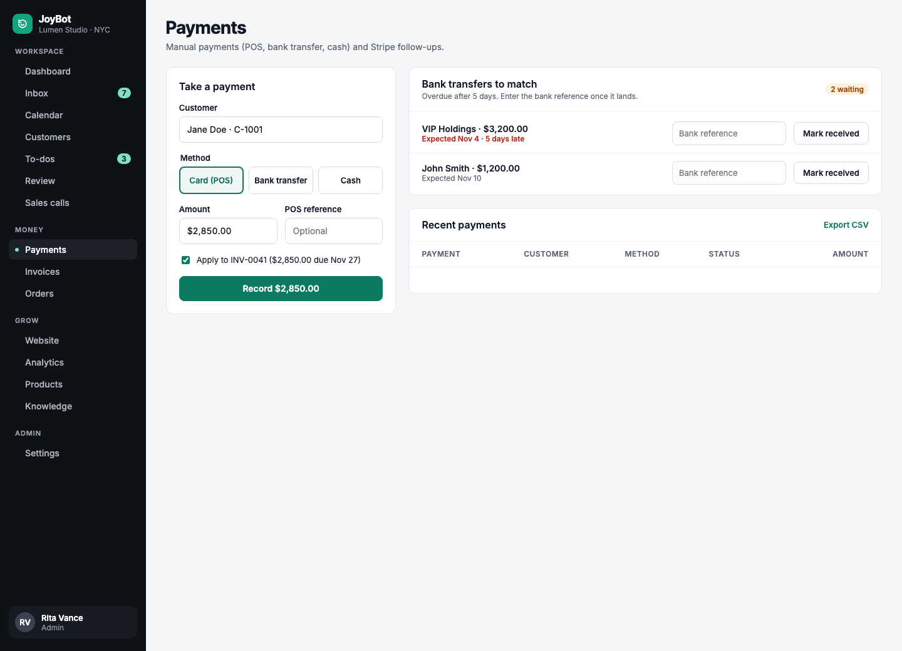

### Sales calls
Website visitors who booked a call, the selected call's details, the Meet link, their question, notes and follow-up emails.

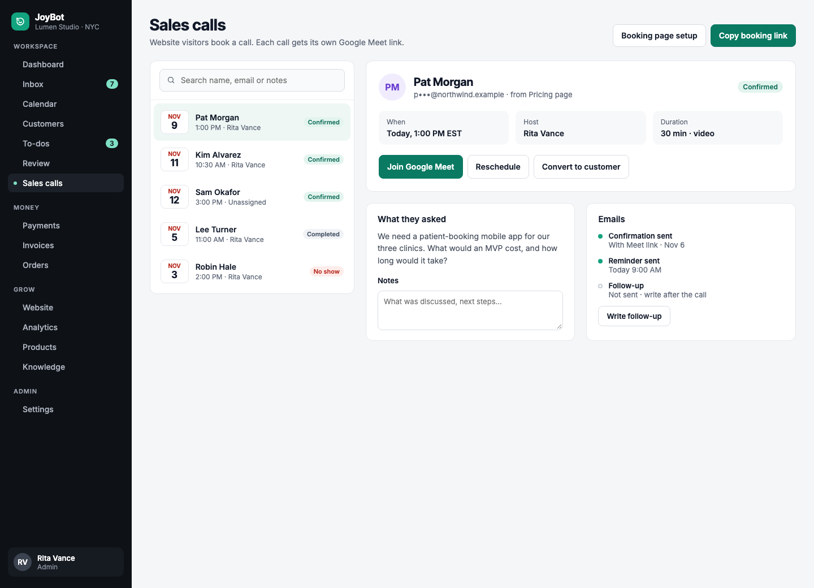

### Knowledge
"What would the assistant find?" tester, saved answers, and the answer editor with example questions and buttons.

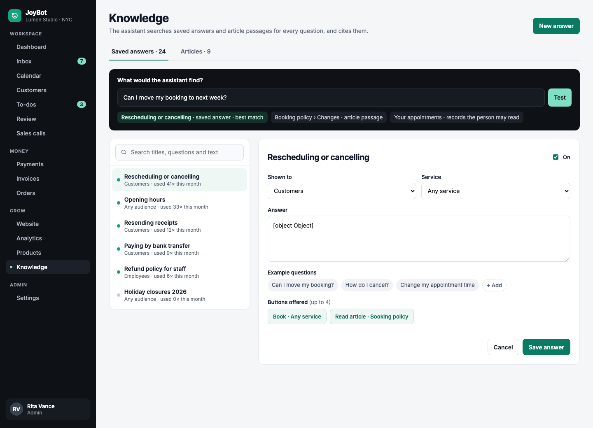

### Settings › AI
Assistant on or off for customers and employees, the answer mode (Model, Auto, or search only), the chat model and a test.

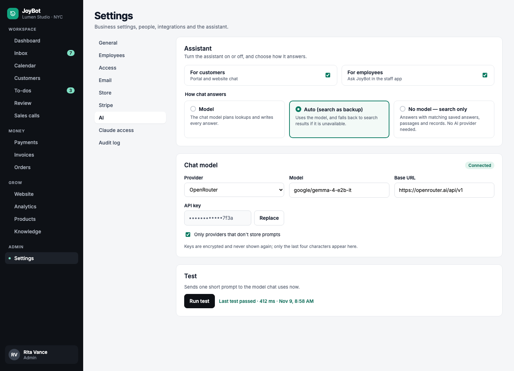

## Customer portal

### Assistant
Answers with sources and buttons from saved answers, suggested questions, and the next appointment, balance due and open ticket.

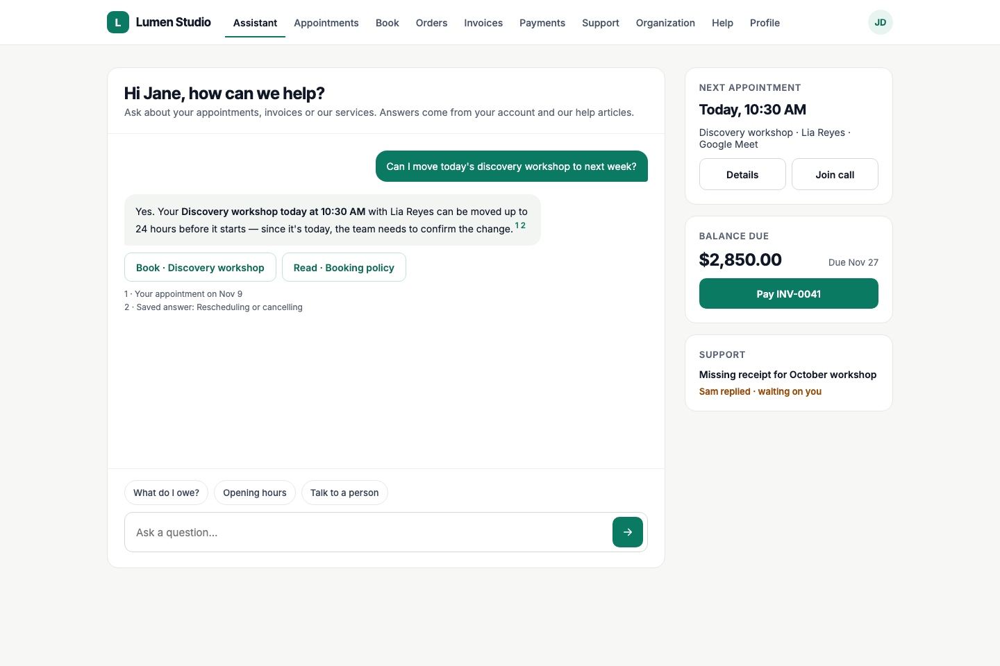

### Appointments
The next appointment with Reschedule and Cancel, upcoming appointments including a request still waiting for confirmation, and past visits with Book again.

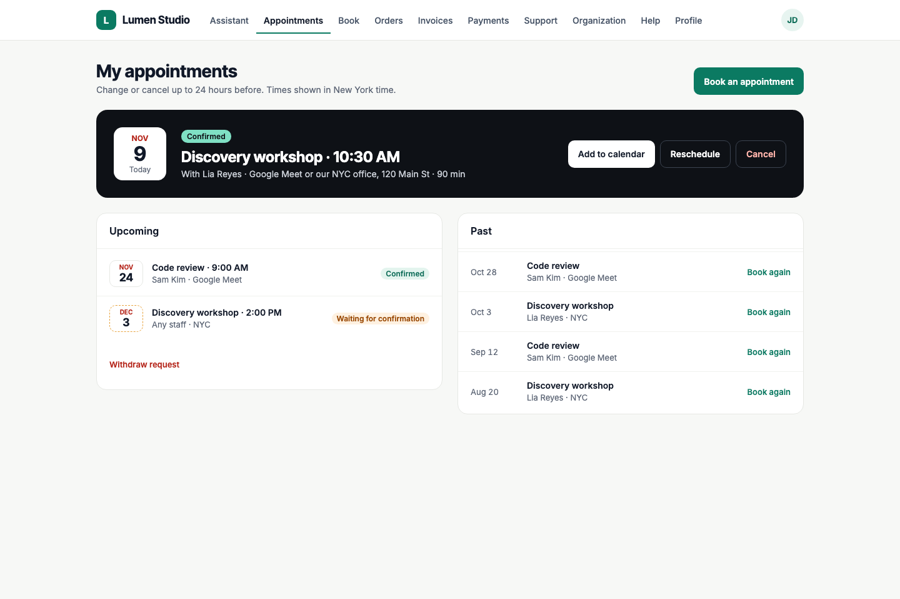

### Book
Service, location (including remote), day and time, with a live summary and Request this time.

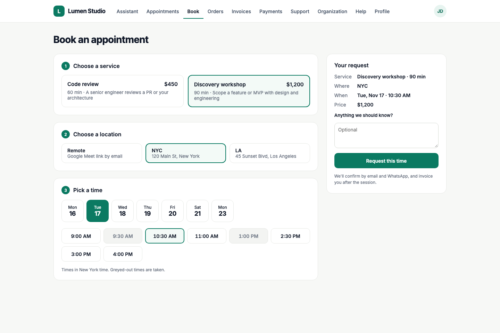

### Pay an invoice
The invoice, and payment by card (Stripe checkout) or bank transfer with the reference to use.

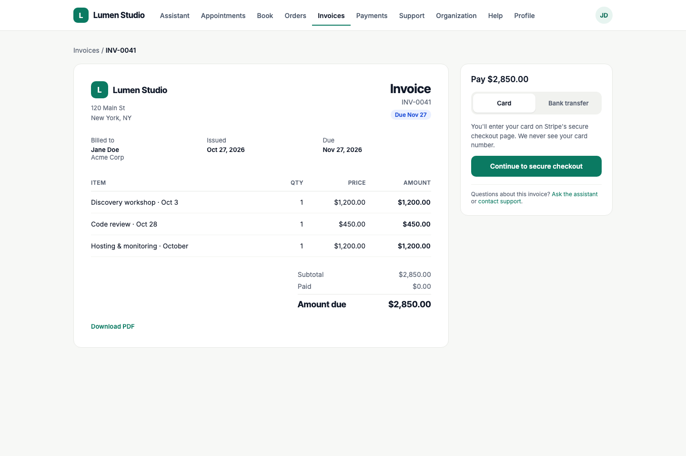
